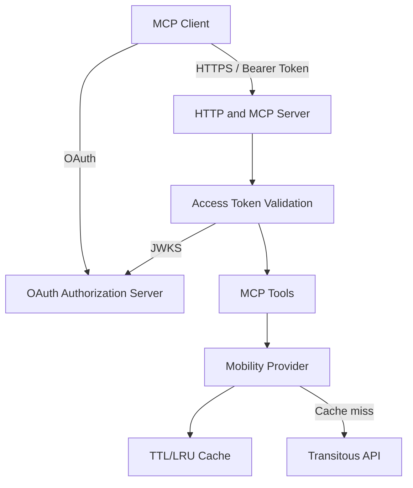

# mrcsx-mobility

A lightweight, self-hosted Model Context Protocol (MCP) server
for public transport integration.

**Current version:** 0.3.0

## Features

- Remote MCP server using Streamable HTTP
- Mandatory OAuth 2.0 authentication
- JWT access token validation with remote JWKS
- Explicit OAuth client and user authorization
- Public transport stop, address and place search
- Transitous integration
- Provider-independent mobility data model
- Bounded in-memory TTL/LRU cache
- Concurrent request deduplication
- Upstream request rate limiting
- Hardened, non-root Docker runtime
- Automated unit, integration and container tests

## MCP tools

| Tool | Description |
| --- | --- |
| `mobility_ping` | Connectivity check with optional nonce |
| `mobility_search_places` | Search stops, stations, addresses and places |

All MCP tools are read-only and require authentication.

Journey planning, departures and real-time transport information
are not yet implemented.

### Example search

```json
{
  "query": "Braunschweig Hauptbahnhof",
  "type": "stop",
  "limit": 5
}
```

Search results contain normalized geographic information,
provider identifiers and available transport modes.

Addresses without provider identifiers return `id: null`
and can be referenced using their coordinates.

## Architecture



The mobility provider is shared across MCP server instances
within the application process.

## Configuration

### Server

| Variable | Default |
| --- | --- |
| `MOBILITY_HOST` | `127.0.0.1` outside Docker |
| `MOBILITY_PORT` | `3100` |
| `MOBILITY_PUBLIC_HOST` | Optional |

### OAuth

All OAuth variables are required.

| Variable | Description |
| --- | --- |
| `MOBILITY_OAUTH_ISSUER` | HTTPS authorization server issuer |
| `MOBILITY_OAUTH_RESOURCE` | Public HTTPS MCP resource URL |
| `MOBILITY_OAUTH_JWKS_URI` | Authorization server JWKS URL |
| `MOBILITY_OAUTH_SCOPE` | Required scope: `mobility:read` |
| `MOBILITY_OAUTH_CLIENT_ID` | Authorized OAuth client UUID |
| `MOBILITY_OAUTH_ALLOWED_SUBJECT` | Authorized user UUID |

Pocket ID is the currently tested authorization server.

The application validates JWT signatures, token type, issuer,
audience, expiration, issue time, client identifier, subject
and required scope.

The server refuses to start without valid OAuth configuration.
There is no unauthenticated MCP mode.

### Transitous

| Variable | Default |
| --- | --- |
| `MOBILITY_TRANSITOUS_BASE_URL` | `https://api.transitous.org` |
| `MOBILITY_TRANSITOUS_USER_AGENT` | Required |
| `MOBILITY_TRANSITOUS_TIMEOUT_MS` | `5000` |

The User-Agent must identify the application, version and
operator contact information.

Example:

```text
mrcsx-mobility/0.3.0 (mailto:operator@example.org)
```

## HTTP endpoints

| Endpoint | Authentication |
| --- | --- |
| `/health` | Public |
| `/.well-known/oauth-protected-resource/mcp` | Public |
| `/mcp` | Mandatory OAuth |

Deploy behind an HTTPS reverse proxy. Do not expose the
application's plain HTTP port directly to the internet.

The health endpoint indicates application availability,
not upstream Transitous availability.

## Provider resource limits

- Request timeout: 5 seconds by default
- Maximum response size: 1 MiB
- Maximum concurrent upstream requests: 2
- Minimum interval between upstream requests: 1 second
- Cache TTL: 15 minutes
- Maximum cache entries: 128
- Maximum serialized cached value size: 4 MiB in total
- No automatic retries
- No background polling

These are application-level limits, not official Transitous quotas.
They apply per provider instance.

## Privacy

The application does not persist search queries or results.

Search queries and results are temporarily cached in memory.
Search queries are transmitted to the configured external
mobility provider.

OAuth access tokens, cookies and user identifiers are not
forwarded to Transitous.

Operators and users should avoid including unnecessary personal
information in search requests.

See the Transitous privacy policy:
https://transitous.org/privacy/

## Data sources and attribution

This project uses Transitous for public transport and geographic data.

- Transitous: https://transitous.org/
- Data sources: https://transitous.org/sources/
- API usage policy: https://transitous.org/api/
- © OpenStreetMap contributors:
  https://www.openstreetmap.org/copyright

Applications and MCP clients displaying results must preserve
appropriate visible attribution and comply with the applicable
data source licenses and API usage policies.

The MIT license of this project does not cover third-party
transport or geographic data.

## Development

Requirements:

- Node.js 24
- npm
- Docker and OpenSSL for container smoke tests

Install dependencies:

```bash
npm ci --ignore-scripts
```

Run type checking and automated tests:

```bash
npm run check
```

Build the container and execute smoke tests:

```bash
docker build -t mrcsx-mobility:dev .
bash tests/docker/run.sh mrcsx-mobility:dev
```

Automated tests use simulated OAuth and Transitous endpoints.
They do not require access to the public Transitous API.

## Roadmap

- [x] v0.1.0: MCP connectivity
- [x] v0.2.0: Mandatory OAuth authentication
- [x] v0.3.0: Transitous and geographic search
- [ ] Journey planning
- [ ] Departure and arrival information
- [ ] Real-time transport information
- [ ] Additional provider implementations

## License

MIT. See [LICENSE](LICENSE).
